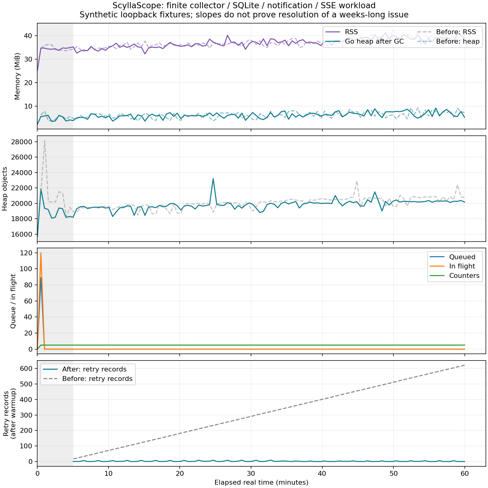

# 継続レビュー・検証結果（2026-10-25）

後続の[RSS切り分け結果](RSS-ISOLATION-RESULTS.md)で、下記60分試験はclientも同processに含むことを明確化し、外部clientによる逐次比較と追加修正を行った。本書は当時の履歴であり、現在の受け入れ判定は後続結果を参照する。

既存Draft PR #1で、通知・メモリ保持・更新手順の不具合を独立レビューし修正しました。**RSSの正の傾きは残っており、数週間の問題の解消判定はしていません。正式版昇格・マージ・タグ・リリースは保留です。** 本番には接続・変更していません。

## 修正と通常検証

[独立レビューの修正一覧](CONTINUATION-REVIEW.md)にN01〜N07、L01〜L03の再現条件と対策を記録しました。通知を後から有効化した際のpending欠落、Unknown中のheartbeat停止、再発と遅延復旧の競合、全active履歴の一時map集積、重複行による確認回数水増し、ハング宛先の逐次ブロック、期限切れretry情報の不要保持を修正しています。

配送は32有限worker、AM宛先最大8並行、キュー128、inflight最大160、retry記録2048までです。520件のハング混在配送とshutdown待機を回帰しました。インストーラーは親symlink・管理外active/enabled unit・systemd manager不在を配置前に拒否します。

Go 1.27.3、正規依存でbuild/test/vet/raceを実施しました。通常回帰は114トップレベル成功（subtest込み141）。通常実行でskipするのは、明示opt-inの長時間3件、巨大旧DB1件、実Scylla2件です。native allocator診断は専用build-tagのため通常buildに含まれません。Nodeの個別18件、ビルド保護5件、実Chromium21件も成功しています。最終HEADでの再確認とCIはPR本文にも記録します。

長時間起動したデモでは1h/6hの両方が480件へ間引かれ、以前のブラウザ試験の「件数は異なるはず」という前提が誤りと判明しました。試験はHTTP応答の時間範囲と、1hへ戻した後のcache描画を確認する形へ修正しています。

## 60分×2の比較

比較対象は**retry期限回収の1行修正前後**です。元RCと完成版の全変更を比較した実験ではありません。両方とも他の独立レビュー修正を含みます。ランタイム基準は修正前f12f40d、修正後7283224。測定binaryのSHA-256と全時系列は[before](validation/extended-before.json) / [after](validation/extended-after.json)へ記録しました。

各3600秒、Go 1.27.3、GOMEMLIMIT=128MiB、同じcollector/engine/SQLiteプロセスを再起動せず使用しました。4,096件のpendingと600件のactiveを事前投入し、250ms更新、5秒ごとの合成ノード入替、1分ごと10秒のdiscovery失敗、2分ごと45秒の通知先503、認証HTTP/SSEを同時実行しました。初期5分を除き、30秒ごとにGC後heap/objects/RSS等を記録し、5分・30分・終了時にheap profileを採取しました。

| 指標 | 修正前 | 修正後 |
|---|---:|---:|
| collector更新 | 14,302 | 14,274 |
| SSE受信 / 再接続 | 30,110 / 1,506 | 30,052 / 1,504 |
| snapshot GET | 3,599 | 3,599 |
| HTTP/SSE検証失敗 | 0 | 0 |
| 通知先が受けたHTTP要求 / 受理 | 42,165 / 8,914 | 42,022 / 8,914 |
| 意図した503応答 | 33,251 | 33,108 |
| 初期pending終了時 | 0 | 0 |
| retry記録終了時 | 622 | 1 |
| warmup後のretry記録範囲 | 17〜621 | 0〜9 |
| 終了後SSE subscriber | 0 | 0 |

通知先503は意図した障害であり「失敗0」に含めて隠していません。受理はHTTP応答レベルで、最終receiverへのexactly-onceを意味しません。初期pending処理完了は、後続の全通知の必達を保証しません。durable_workは通知済みactiveも含む作業対象件数です。

## メモリの傾向と保持元

下表は稼働中sampleの記述的OLSです。単位はMiB/時、objects/時。終了時のSSE停止・idle接続解放後の値は傾きから除外しました。周期負荷・相関sampleであり統計的有意性や数週間への外挿は示しません。

| 指標 | 修正前: warmup後全体 | 修正後: warmup後全体 | 修正後: 最後20分 |
|---|---:|---:|---:|
| GC後heap alloc | +2.06 | +2.17 | +0.24 |
| HeapObjects | +1,905 | +1,223 | +522 |
| RSS | +5.93 | +5.95 | +4.02 |

5分中央値からのheap傾きも修正前+2.02、修正後+2.08MiB/時でした。**retry記録の不要保持は改善しましたが、全体RSSの傾き改善は確認できません。** 初期/終了値への復帰やテストPASSを、長期メモリ問題の解消と読み替えません。



表示件数は開始時から500件ですが、空messageのseedがprobe結果付きの新しいincidentへ置き換わり、payloadのバイト数は同一ではありません。通常履歴と退役activeもDB上で増加します。保持168時間のため、この60分では通常履歴の期限切れまでは検証していません。短い別のScylla試験やcompileも同じホストで動いたため、厳密な制御性能比較ではありません。さらに前後runは同一ホストで約39分49秒重なっています。変更前は最初20分が単独・残り40分が並行、変更後は最初40分が並行・最後20分が単独です。したがって修正後の尾部heap傾きの変化をretry修正の効果へ帰属することはできません。

profileの主な差分は、SSE scanner buffer、snapshotのIncident clone/copyTime、JSON処理でした。sampled profileの推定objectsとMemStats.HeapObjectsの実件数は区別します。終了profileはSSE/HTTP停止後なので、そこでの減少をリーク不在の証明にしません。Go profileだけでは下記C allocator全体は見えません。

後半の自然GC時runtime APIでは、両プロセスともGoSysは32,373,000Bで一定でした。idle/releasedとRSSは変動しています。これはGoSysがRSSではないことを示しますが、RSS差を特定allocatorへ単独帰属はできません。名前付きGo VMAラベルは観測できず、匿名領域集計をC領域だけとは解釈しません。

## 実施できた隔離統合

- **実ScyllaDB 6.2.3**: 本番adapterのQuery/Discover、DB停止中の失敗、同adapterでの再接続、Close後拒否を通常/raceで成功。別fixtureでPasswordAuthenticator＋正しいCA/hostname成功、誤password・無資格情報・誤CA・誤hostname拒否と、その後の正常control成功。fixtureと秘密の一時ファイルは削除済み。[結果](validation/scylla-integration.json)、[再現手順](../tests/integration/README.md)
- **実Alertmanager 2-process HA**: 配送担当を実際にSIGTERM停止し、survivor経由の別障害・片側/全体復旧、永続storageでの再起動・再join、短い重複抑制窓と新障害の到達を2回確認。[結果と限定](validation/ALERTMANAGER-HA.md)
- **旧SQLite20万行**: pendingフィールドなし、active1,201・古いresolved198,799。追加index前後の全内容digest不変、UI500/Work1,201、prune後active不変、再open/integrity_check成功。初回Open/index作成0.526秒、prune1.025秒。[結果](validation/legacy-db-200k.json)
- **Go外メモリ**: 専用memory.counters buildで35秒、28,888回の実SQLite上書き・読込。Close＋GC後live allocationは388→4へ減る一方、mappingは約6MiBを保持。native mappingとRSSは別で、GoSysも増えたためRSS差の全量は帰属しない。[静的根拠・診断と限界](NATIVE-MEMORY.md)

全DB・受信口は使い捨ての隔離fixtureです。本番には接続していません。Scylla fixtureの初回1GiB設定は見える物理500MBにより起動失敗し、384MiB/1shard/developer-modeで検証しました。本番推奨構成ではありません。

## 未実施・受入条件

- **実systemd更新・失敗復元・アンインストール**: 未実施/環境制約。PID1はtail、/run/systemd/systemなし。daemonバイナリ自体はありますが、read-onlyのsystemctl showは「systemd as initで起動していない/system scope bus Host is down」で失敗。以前の「実行ファイルなし」は訂正。PID1置換・ホストcgroup変更・本番操作は試みていません。
- **長期メモリの合格判定**: 未達。正のRSS傾きが残り、主因も未確定。固定データ量/固定payloadとnative allocator counterを併記した切り分け、本番相当の実CQL・ノード入替を含む2〜4週間の実時間測定が必要です。
- 実Scyllaの複数ノード/分断、初期session作成中cancel、mTLS・証明書rotation、v6.2.3以外、長期CQL driver割当。
- 実AMネットワーク分断/遅延/clock skew、SIGKILL・ディスク喪失、異ホスト間HA、長期repeat/strict exactly-once。
- ARM実機、巨大な実運用DBの全schema/破損/低disk/並行writer、Docker製品イメージbuild。

通常sandboxのDocker socket拒否は、明示local socketを追加権限で使う隔離操作で解決し、fixtureを削除しました。未解決の自動承認拒否や結果不明の書込操作はありません。既存LICENSE一致、秘密/内部設定/実ログの除外を継続しています。

## 再現

ブラウザ試験は、別端末で `go run ./cmd/devserver` を起動し、loopbackの8765番で応答することを確認してから実行します。長時間試験の出力先は新しい書込可能ディレクトリを選びます。

```bash
./build.sh
CHROMIUM_BIN=/path/to/chromium python3 tests/e2e/test_browser.py
SCYLLASCOPE_LONG_SECONDS=3600 SCYLLASCOPE_LONG_OUTPUT=/tmp/scyllascope-long-new GOMEMLIMIT=128MiB go test -timeout=75m -count=1 -v ./internal/monitor -run '^TestLongCollectorSoak$'
python3 tools/analyze_long_soak.py /tmp/scyllascope-long-new/samples.jsonl --output summary.json
python3 tools/plot_long_soak.py summary.json chart.png
```

Scylla/HA/native診断は各手順のopt-inで実行します。生ログ、DB、秘密鍵、raw profileは公開せず、公開した時系列は識別子を含まない合成負荷の数値だけです。
