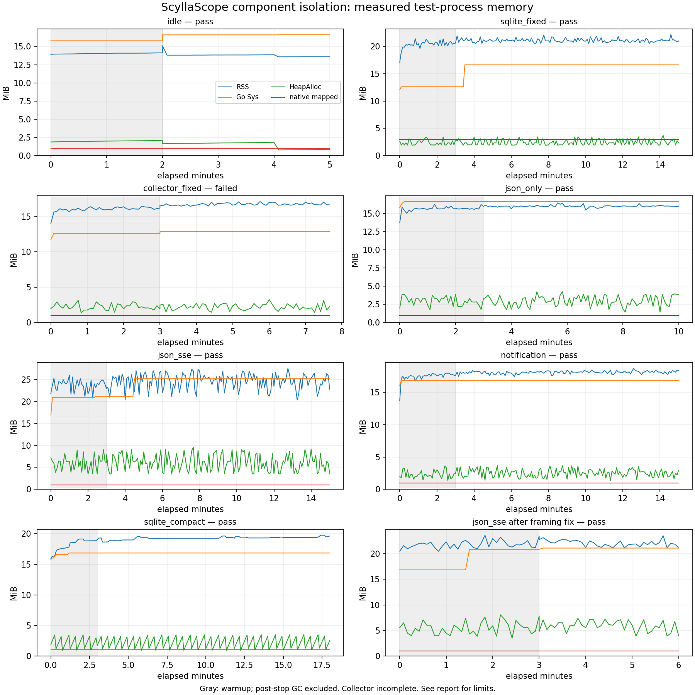

# RSS切り分け・allocation削減の最終検証

長期RSS問題の受け入れ判定は**未達**。根拠のあるTopology縮小とSSEの不要コピー削減は実装・回帰済みだが、数週間の解消は証明していない。collectorのloopback接続失敗2件も未解明として保持した。マージ・タグ・正式公開は行わない。

## 修正と根拠

- 再起動Topologyは必要なmetadataだけを保存する。実collector回帰では526,741→2,980 bytes、拡大fixtureでは1,338,534→2,974 bytes。旧full/newcompactの再起動・fallback、クラスタ不一致、metadata時刻非延長、配信側のincidents/events/metrics/edgesを維持。Storeの汎用round-tripは変更しない。
- SSEはheader・JSON bytes・終端を同じ5秒deadlineの下で分けて書き、1回flushする。大きいformatted stringを作るコピーを除いた。large Unicode JSON/wire、各部分のshortwrite/write error、flush failure、slot/購読の解放を回帰。

| framing-only benchmark | B/op | allocs/op |
|---|---:|---:|
| formatted | 802,955 | 5 |
| parts | 32 | 1 |

JSON生成・socket・clientを含まない固定約393KBのmicrobenchmarkである。ns/opやMB/sをネットワーク性能やRSSへ換算しない。

## 有限な逐次測定

case processのwall time合計（両失敗・60秒診断・修正後確認を含む）は **93.10分**、上限95分以内。各caseは新しいprocessで逐次実行し、最長18分。これは単一processの約93分連続稼働ではない。準備・調査・build・資料整理を含む全体wall-clockとは区別する。

Go1.27.3、GOMEMLIMIT128MiB、GOGC100、GOMAXPROCS2、5秒sample。固定3 nodes/500 incidents、同一input約393KB、履歴/eventを蓄積しない。測定中は強制GC・cache削除・DB再起動・trimなし。外部client/receiver RSSはserver RSSへ加算しない。post-stop GC1回は別diagnosticで傾きから除外した。

| case | 状態/実観測 | RSS中央値 MiB | RSS OLS MiB/h | 末尾1/3 OLS MiB/h | native mapped MiB | native live件数 | 自然GC差 |
|---|---|---:|---:|---:|---:|---:|---:|
| idle | pass / 5.00分 | 13.82 | -6.79 | -6.37 | 1.00 | 2 | 2 |
| sqlite_fixed | pass / 15.00分 | 21.00 | -0.19 | 2.72 | 3.00 | 356 | 3822 |
| collector_fixed | failed / 7.67分 | 16.68 | 2.92 | 0.75 | 1.00 | 2 | 402 |
| json_only | pass / 10.00分 | 16.02 | 0.20 | -0.06 | 1.00 | 2 | 1115 |
| json_sse | pass / 15.00分 | 24.96 | 0.09 | 9.07 | 1.00 | 2 | 1869 |
| notification | pass / 15.00分 | 18.10 | 1.10 | 0.42 | 1.00 | 2 | 1575 |
| sqlite_compact | pass / 18.00分 | 19.31 | 1.99 | 3.25 | 1.00 | 260 | 33 |
| json_sse after framing fix | pass / 6.00分 | 22.09 | -16.77 | -7.93 | 1.00 | 2 | 259 |

OLSはwarmup後の通常sampleだけの記述値。GC位相・相関・短い区間で変化する。特に修正後SSEは6分全体/3分warmupであり、傾きの改善/悪化を因果や週単位の合格判定へ置き換えない。HeapAlloc/HeapObjectsは自然GC前のgarbageも含み、正確なlive heapではない。native liveは件数で要求bytesではなく、mappedは空きpoolを含みRSSとも異なる。

## 失敗・測定条件の逸脱

- 初回collectorは15.52秒でgeneric probe検証失敗。詳細不足のためCQL/TCPを復元できない。
- 同じ200ms probe/1秒fixture deadlineの60秒診断は240 refresh、CQL SUPPORTED720、fixture accepted1440、非EOF read/write失敗0で成功した。開始/終了約10:07:28–10:08:28 UTCはGC ageから復元した概算。
- 診断付き再確認は461.53秒でCQL Dialが201.34msのi/o timeout。直後のInternode TCPは0.53msで成功。fixtureのread/write失敗0、最大handler開始遅延14.11ms、header読込182.59ms。メモリ閾値超過ではないが原因は未特定。3回目は実行していない。成功60秒で失敗を取り消さない。
- collectorだけ詳細エラー/fixture統計の診断binary。production sourceは同じ。SQLite full/compactは同一原binaryのまま。SSE修正後は新binaryで別確認し、各source/hashをJSONへ記録。
- collectorには同processの小さなTCP/CQL/HTTP fixture、補助execが含まれ、実gocql sessionは使っていない。SQLite Save+Load4Hzは本番の起動時Loadを増幅しており、RSS差を本番の定常改善量へ直結させない。
- 自分たちのbuild/他負荷試験はcaseと重ねなかった。補助host観測は途中からであり専有hostの保証はない。loadavgには測定前のbuild/browserの履歴も含む。

## profileと保持元の解釈

前回60分×2の約+5.9MiB/hはHTTP/SSE clientを同processに含む値で、run重複・payload/DB増加もあった。server単体の漏れ速度やretry修正効果には帰属できない。既存profile/SQLite診断を再利用し、今回clientを外部化して切り分けた。

baseline SSEのwarmup→end alloc_space差分は推定8,481,462,123 bytes、そのうちfmt.Sprintf累積4,617,238,264 bytes（54.44%）。これは約12分に発生した一時allocationで、live heapや漏れbytesではない。修正はこの不要コピーを対象とする。

- before のprofile差分推定total: 8,481,462,123 bytes / 約720秒（11.23MiB/秒）。sampled推定でありMemStats.TotalAllocそのものではない。
- after のprofile差分推定total: 948,922,841 bytes / 約180秒（5.03MiB/秒）。sampled推定でありMemStats.TotalAllocそのものではない。

自然GCのinuse profileは時点/GC位相とsample誤差の影響を受け、特定保持rootの完全なグラフではない。native poolはmodernc memory v1.12.1の4MiB+過去高水位hiLive、size classごとのcarve/hot領域等があり、固定4MiBやRSS全体の上限とは言えない。[独立解釈レビュー](ISOLATION-INTERPRETATION-REVIEW.md)参照。

## 実施済みと残る受け入れ条件

- 修正runtime source58b5dbbでbuild.sh（全体test/vet/race、modules verify、production build）、linux AMD64/ARM64、frontend再現性、Node18、build gate5、Chromium21、govulncheck指摘なし。最終docs-only HEADのCIはPRで確認する。
- 既存の実ScyllaDB6.2.3認証/TLS/stop/reconnect/Close、実AMのepisode/2-process HA、旧SQLite200k行/active1201件の整合性・prune/reopen試験は[前回結果](CONTINUATION-VALIDATION.md)を再利用。今回の継続負荷500件と500件超の機能検証は別である。
- **未検証**: 実gocqlを含む固定/可変payload・node入替・通知遅延/失敗・履歴retention定常化を伴う2〜4週間の隔離環境受入。自然GCでGo heap/profileとRSS/nativeを同時に追い、高水位と持続増加を分離し、問題が再現する条件を特定する。専用hostとloopback Dialのsyscall/packet/scheduling観測が必要。今回200ms timeoutの原因は解消と呼ばない。
- **未検証**: 実systemd hostでのinstall/update/uninstall/旧版rollback、config/secret/監視DB保持、ScyllaDB本体のservice/config/dataが無変更であること。現在PID1はsystemdでなくmanager busが利用不可。systemd実行ファイルは存在する。PID1/cgroup/権限やsecurity設定を変えて試験を通すことは行っていない。
- AMの全台同時喪失/partition/SIGKILL/disk loss、実receiver必達/完全なexactly-onceは保証していない。既存の具体的制限を維持する。
- 既存LICENSEは不変（SHA256 d377ca5f9d438777715a903dd000ade1d4e7088804812672191337e5024de992）。実設定・認証情報・内部アドレス・元ログを追加せず、本番接続/変更なし。

## 証拠と再現

- [public-safe数値・全失敗・source/hash](validation/isolation-summary.json)（raw URL/PID/path/token/log/profileは含まない）
- [baseline allocation差分](validation/sse-alloc_space-before.txt) / [修正後](validation/sse-alloc_space-after.txt)
- [baseline inuse差分](validation/sse-inuse_space-before.txt) / [修正後](validation/sse-inuse_space-after.txt)
- [実行計画/変更理由](ISOLATION-PLAN.md)、tools/run_isolation.py、tools/analyze_isolation.py、tools/combine_isolation.py、tools/plot_isolation.py。raw testcase log/DB/key/profileはprivate一時領域に保持し公開しない。
